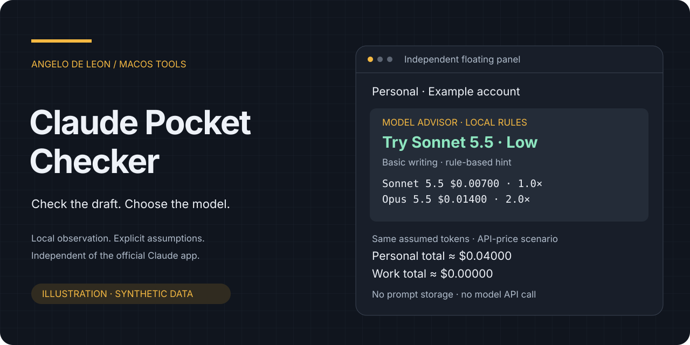
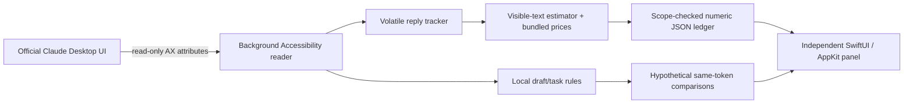

<p align="center"></p>
<p align="center"></p>
<h1 align="center">Claude Pocket Checker</h1>
<p align="center"><strong>Check the draft. Choose the model. Keep working.</strong></p>
<p align="center">A small macOS companion for more deliberate Claude use: see local estimates and consider the model before you send.</p>
<p align="center">
<a href="https://github.com/RaDeleon/Claude-Pocket-Checker/releases"></a>
<a href="https://github.com/RaDeleon/Claude-Pocket-Checker/actions/workflows/ci.yml"></a>
<a href="https://github.com/RaDeleon/Claude-Pocket-Checker/releases"></a>
<a href="LICENSE"></a>
<a href="https://github.com/RaDeleon/Claude-Pocket-Checker/stargazers"></a>
</p>
<p align="center"><a href="https://github.com/RaDeleon/Claude-Pocket-Checker/releases/download/v0.2.2/Claude-Pocket-Checker-0.2.2-universal-macOS.dmg"></a></p>
<p align="center"><a href="#quick-start">Quick start</a> · <a href="#architecture">Architecture</a> · <a href="docs/PRIVACY.md">Privacy</a> · <a href="docs/VALIDATION.md">Validation</a> · <a href="docs/website/README.md">Portfolio kit</a> · <a href="https://github.com/RaDeleon/Claude-Pocket-Checker/issues">Issues</a></p>
<p align="center"></p>



> **Experimental preview.** Token counts are visible-text estimates. API-equivalent prices are not a subscription bill or a measurement of Team-plan consumption. Independent project; not affiliated with Anthropic.

## Why I built it

I do much of my Claude work in regular Desktop Chat, with local tools connected to my Mac. A browser-only meter did not cover that workflow. I wanted a separate observer that would keep the official app intact and help me notice when I was choosing an expensive model for a routine task.

Claude Pocket Checker reads the interface through macOS Accessibility, displays an independent floating panel, and keeps the accounting and recommendation limits explicit.

## Features

| Feature | What it does |
| --- | --- |
| Floating meter | Estimated input/output tokens and API-equivalent cost after new observed replies. |
| Chat and account totals | Local numeric ledger, with separate Personal and Work scopes. |
| Draft advisor | Reads unsent draft text in memory and suggests a model/effort starting point. |
| Transparent rules | Local task rules, task override and optional Haiku suggestions; no model API call. |
| Cost scenarios | Compare the same assumed token counts across the recommendation, selected model, Opus and Fable. |
| Explicit controls | Configure account labels, pause reads, resume with a fresh baseline, or quit completely. |

## Quick start

**Download the app — no build tools required:** [macOS universal DMG](https://github.com/RaDeleon/Claude-Pocket-Checker/releases/download/v0.2.2/Claude-Pocket-Checker-0.2.2-universal-macOS.dmg) · [App ZIP](https://github.com/RaDeleon/Claude-Pocket-Checker/releases/download/v0.2.2/Claude-Pocket-Checker-0.2.2-universal-macOS.zip) · [Checksums](https://github.com/RaDeleon/Claude-Pocket-Checker/releases/download/v0.2.2/SHA256SUMS-macos.txt).

Requires macOS 14+ and the official Claude Desktop app. The universal binary contains Apple Silicon and Intel code; Intel runtime acceptance remains open. Open the DMG, drag **Claude Pocket Checker** to **Applications**, eject the disk image, then launch the installed copy.

**Signing status:** this preview is ad-hoc signed and is **not Apple-notarized or Developer ID signed**. macOS may block first launch. If you trust the download, follow Apple's per-app **Privacy & Security → Open Anyway** process. [Full install, permission, checksum and removal instructions](docs/INSTALL.md) · [Apple's opening-apps guidance](https://support.apple.com/en-us/102445). No Gatekeeper-disabling commands or quarantine-removal scripts are included.

### Build from source (optional)

**Source-build requirements:** macOS 14+, Xcode's Swift toolchain and a running official Claude Desktop app. Local checks used an Apple Silicon Mac. Other hardware/OS combinations need their own acceptance checks.

```sh
git clone https://github.com/RaDeleon/Claude-Pocket-Checker.git
cd Claude-Pocket-Checker
swift test
./script/build_and_run.sh --build
open 'dist/Claude Pocket Checker.app'
```

1. Open **Account labels for this Mac** in Pocket Checker. Enter the exact account-button labels displayed at Claude's bottom-left for Personal and Work. No personal account labels ship in the source.
2. Enable the companion's **Accessibility** permission in System Settings. Newer macOS versions may call this pane **Device Control and Data Access**. Grant only the app you built and intend to run.
3. Open a regular Desktop Chat. Existing history is baselined; it is not added as historical spending.
4. Type an unsent draft for local guidance, or submit a new prompt and let the response settle.
5. Change the model and effort yourself in Claude if you choose. Pocket Checker never clicks, types or sends a prompt for you.

The source includes build, probe, process-verification and log modes. `--build` builds/signs only; it does not launch the app. Close the panel or choose **Quit** to stop the process. Nothing registers at login.

**Distribution status:** experimental prebuilt app preview, supplied as a universal DMG and ZIP alongside source. Release and local builds use ad-hoc signing; Developer ID signing and notarization remain future work. An update can require a new Accessibility grant. A fresh-Mac installation and Intel runtime validation remain manual acceptance work.

## Before-send model advice

The advisor uses deterministic keyword/length rules, not an AI call. It is a transparent starting point:

| Draft signal | Default starting point |
| --- | --- |
| Bounded rewrite / extraction | Sonnet 5.5 · Low; optional Haiku if available in the account. |
| Bounded coding | Sonnet 5.5 · Medium. |
| Difficult, cross-system reasoning | Opus 5.5 · High. |
| Unclear / tool-based work | Sonnet 5.5 · Medium, marked uncertain. |
| Consequential review | More careful review guidance; model selection does not establish correctness. |

Override the task category when the guess is wrong. The advisor cannot see all hidden context or attachments, does not benchmark answer quality, and never guarantees identical answers. A premium model can help with a harder task even when a keyword rule misses that difficulty.

Comparison rows use estimated visible input plus **200, 500 or 2,000 hypothetical output tokens**, selected by the user. At equal token counts, a price ratio is meaningful; it is not an exact prediction of Team-plan consumption or effort-generated tokens. Unknown models remain unpriced. See [ACCOUNTING](docs/ACCOUNTING.md).

## From draft to decision

1. **See the task.** The local advisor reads the unsent composer text in memory and suggests a task category, model and effort. Override the category when the rules miss your intent.
2. **Compare the assumption.** The panel shows a same-token API-price scenario. It does not predict your exact quota use or promise an identical answer.
3. **Keep the choice.** Change the model yourself in Claude, send when ready, and let the companion record the next settled reply into the recognized account's local total.

## Setup questions

<details><summary><strong>macOS blocked the app</strong></summary>

The downloadable preview is ad-hoc signed and not notarized. Use the app-specific approval described in [Install](docs/INSTALL.md) only if you trust the release and your organization allows it. We do not disable Gatekeeper. Developer ID signing, notarization and clean-Mac acceptance remain separate release work.

</details>

<details><summary><strong>The panel cannot recognize my account</strong></summary>

Enter the exact account-button labels shown in your Claude window using **Account labels for this Mac**. The public app ships with empty labels. Unknown or overlapping labels deliberately pause tracking so personal activity cannot be guessed into Work. Only the current regular Desktop Chat is observed; the Code tab is excluded.

</details>

<details><summary><strong>Will this control Claude or send my drafts elsewhere?</strong></summary>

No. This companion reads Accessibility attributes and gives local advice. It has no keyboard hook, prompt submission, Claude login, API call or background upload. Draft text is processed in memory; only numeric ledger records persist. Accessibility remains a broad system permission, so review the [privacy boundary](docs/PRIVACY.md).

</details>

## Architecture



| Source | Responsibility |
| --- | --- |
| `Sources/ClaudePocketChecker/AccessibilityReader.swift` | Read focused Claude window, message roles, selected model, draft and configured account label. |
| `Sources/ClaudePocketChecker/main.swift` | Floating panel, controls, local preferences and numeric persistence. |
| `Sources/MeterCore/MeterCore.swift` | Scope matching, tracker, ledger, rates and cost arithmetic. |
| `Sources/MeterCore/Advisor.swift` | Local task classification and comparison scenarios. |
| `Tests/MeterCoreTests/` | Synthetic tracking, isolation, pricing and advisor regression cases. |
| `script/build_and_run.sh` | Build a separate development app bundle and ad-hoc sign it. |
| `script/package_macos.py` | Universal release binary, app icon, signed bundle, DMG/ZIP and checksums. |
| `script/verify_macos.py` | Verify the extracted ZIP and mounted DMG without launching the GUI. |

<details><summary><strong>Accessibility and privacy boundaries</strong></summary>

Accessibility is a broad macOS permission. This implementation reads only the running official Claude bundle (`com.anthropic.claudefordesktop`) and never modifies Claude controls. It installs no keyboard hook, event tap, proxy, certificate, URL handler, browser-default change or startup item. It has no network code or API key.

Draft and transcript text stay in memory. The ledger contains opaque record IDs, hashed chat IDs, scope, model, counts, API-equivalent cost and timestamps. The folder is created mode 0700 and ledger mode 0600. Editable account labels are local preferences. No administrator dashboard or teammate telemetry is transmitted. [Privacy details](docs/PRIVACY.md).

</details>

<details><summary><strong>Tracking and incomplete data</strong></summary>

The estimator uses `ceil(UTF-8 bytes / 4)`. It cannot measure hidden instructions, attachments, all tool payloads, thinking, repeated internal model calls or cache use. Incomplete histories pause commits. A pending observation survives transient hydration gaps; it does not create missing context. Output must settle for three seconds with no recognized generating control. An observed retry can become a new attempt; a fast retry between polls may be missed or merged.

Only the current/focused Claude window is read. Unknown or ambiguous account labels pause tracking, and each chat binds to one scope. The Code tab is excluded. Session/weekly plan percentages are not read by this app. The browser and desktop products have independent ledgers; their totals should not be added as if they measured distinct activity.

</details>

## Validation and current limits

**24 offline tests pass** in the prepared source. The predecessor installed build captured first/follow-up replies, preserved two records through a full process restart, and the owner confirmed normal typing and draft advice with native Computer Use off. Public branding, a separate app/data identity and empty configurable account defaults were compiled and tested in this publication pass; the public app identity was not live-installed over the owner's working copy.

Live Work-account switching, long/virtualized histories, voice, interrupted replies, very fast retries and broad team deployment remain acceptance work. English accessibility labels and Claude's current UI are assumptions. [Full validation notes](docs/VALIDATION.md).

## Local data and removal

```
~/Library/Application Support/ClaudePocketChecker/ledger.json
```

Quit the companion, remove its Accessibility grant, and delete the app to uninstall. Remove that data folder separately if you also want to erase the saved totals; this app has no cloud copy. This public identity does not automatically import a private prototype's ledger or change its installation. Account-label preferences are stored under the companion's bundle identity.

## Development and releases

Run the tests before changing the accounting or privacy boundary. GitHub Actions repeats the source checks with read-only repository permissions. The [release guide](docs/RELEASING.md) explains packaging, checksums and how the download badge works. Release downloads count assets fetched from GitHub Releases; they do not count clones, page views, unique people or active installations. No tracking code is added to the product.

The repository includes a [project-page draft, blog post and portable graphics](docs/website/README.md) for the author's portfolio. Artwork is labeled as an illustration with synthetic data rather than a private-chat screenshot.

## License and acknowledgments

[MIT](LICENSE) · Copyright 2026 Angelo De Leon. Claude and Anthropic names identify compatibility; this project is independent and is not endorsed by Anthropic. Technology icons are from [Skill Icons](https://skillicons.dev/), badges from [Shields.io](https://shields.io/), and the cached repository card below from [GitHub Readme Stats](https://github.com/anuraghazra/github-readme-stats). These README services are not runtime dependencies.

## Repository activity

[](https://github.com/RaDeleon/Claude-Pocket-Checker)
